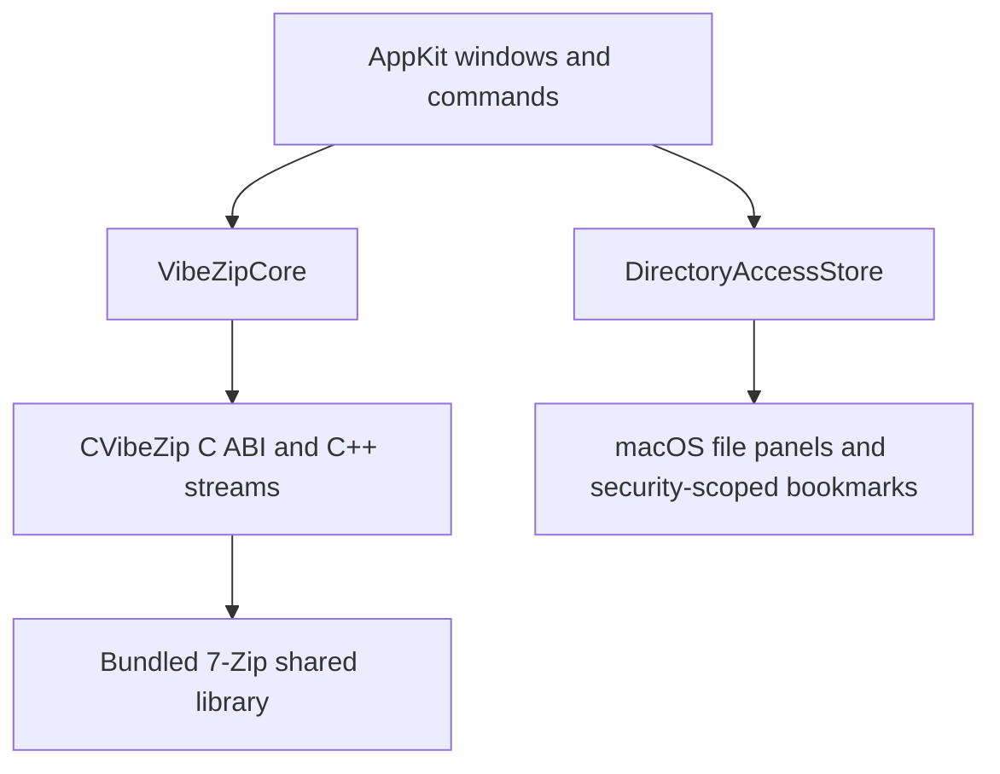

# Architecture

VibeZip provides a native file-manager interface over the archive interfaces in
this 7-Zip fork. The macOS UI uses AppKit controllers and SwiftUI presentation;
the Windows File Manager
UI is not embedded. Archive operations run inside the application process, with
no shell command construction or console-output parsing.

## Components

| Component | Responsibility | Source |
| --- | --- | --- |
| AppKit UI | Navigation, selection, command validation, operation feedback and local preview | [VibeZip/](../macOS/Sources/VibeZip/) |
| SwiftUI browser chrome | Sidebar and live Info inspector hosted in a native split view; no separate archive state or simulated operations | [BrowserChrome.swift](../macOS/Sources/VibeZip/BrowserChrome.swift) |
| Localization | Shared English, Simplified Chinese, Japanese and Korean resources for UI and operation feedback; typed interpolation keeps paths and engine identifiers separate | [Localization.swift](../macOS/Sources/VibeZipCore/Localization.swift) |
| Archive service | Session lifetime, extraction policy, verified updates and nested writeback | [ArchiveService.swift](../macOS/Sources/VibeZipCore/ArchiveService.swift) |
| Metadata and file operations | Entry identity, directory index, path validation, safe copying and staging | [Models.swift](../macOS/Sources/VibeZipCore/Models.swift), [FileOperations.swift](../macOS/Sources/VibeZipCore/FileOperations.swift) |
| Swift engine adapter | Native handle ownership, callbacks and error translation | [Engine.swift](../macOS/Sources/VibeZipCore/Engine.swift) |
| Native bridge | `IInArchive` / `IOutArchive`, stream adapters, passwords, progress and output limits | [CVibeZip.h](../macOS/Sources/CVibeZip/include/CVibeZip.h), [Native.cpp](../macOS/Sources/CVibeZip/Native.cpp) |
| Archive engine | Format handlers, codecs and hashing | [CPP/7zip/](../CPP/7zip/), [C/](../C/), [Asm/](../Asm/) |

The app bundle loads `Contents/Frameworks/libVibeZip7z.dylib`. A missing bundled
engine is an error. Development and test executables may use `VIBEZIP_LIBRARY`
or a local build; the packaged app does not use those fallback locations.

## Sessions and identity

An `ArchiveSession` owns a live native archive handle, an `ArchiveListing`, a root
file fingerprint and its password state. A nested session retains its parent
and any private temporary directory needed to back its stream. The service
keeps weak references to sessions and retains the four most recent root sessions
to make ordinary navigation reusable.

Each real `ArchiveEntry` has its native item index. Paths are display and
namespace information, not a substitute for that identity: an archive may contain
duplicate names. Inferred parent directories have no native index. Selection,
preview and nested opening preserve item indexes; mutations reject ambiguous
namespaces before rewriting them.

Root fingerprints record size, modification time and inode. The service checks
them around reads and before commits to detect ordinary external modifications.
These checks do not provide a lock against other processes or a content hash.

## Scheduling and ownership

[AppDelegate.swift](../macOS/Sources/VibeZip/AppDelegate.swift) retains the browser
windows and routes app-level commands to the active one.
[BrowserWorkspace.swift](../macOS/Sources/VibeZip/BrowserWorkspace.swift) owns one
shared archive service, clipboard scratch files and the active-operation owner.
Window navigation and selection remain independent. Closing a browser releases
its UI, without closing the shared archive service or security-scoped resources.
Closing the last window keeps the app running; app-wide cleanup occurs on Quit.

[MainWindowController.swift](../macOS/Sources/VibeZip/MainWindowController.swift)
runs substantial operations on a serial `OperationQueue`; AppKit updates return
to the main queue. The workspace admits one browser operation at a time across
windows. Other windows keep their metadata snapshot while work is active and
refresh from shared sessions afterward. `ArchiveService` uses a recursive lock, and the native library
serializes access to its active operation and sessions. These boundaries are
important even though a codec may use worker threads internally.

The C ABI is synchronous. Callback context and borrowed input pointers must stay
alive until a call returns. The bridge serializes callbacks; Swift copies returned
metadata and frees native strings, entries and archive-info structures through
the matching C functions. Cancellation is cooperative and travels through the
same callback context as progress. Errors carry typed status, detail and a
message rather than relying on parsing text output.

Folder access is owned on the main thread by `DirectoryAccessStore`. Background
work uses those active process scopes. The engine cannot acquire access or show
authorization panels; the UI handles an access error and retries after a user
selection. See [Sandbox and security](sandbox-and-security.md).

## Large archives and search

Archive contents stream through native input/output interfaces or disk-backed
temporary files. Whole nested archives are not accumulated in Swift `Data`.
Listings are different: metadata for the current archive is held in memory.
`ArchiveListing` builds a directory index, so enumerating a folder depends on its
children rather than rescanning every entry.

Search filters this existing metadata synchronously. Searching an archive is a
linear scan of its indexed paths followed by sorting the matches for display;
it does not open streams, read contents or recurse into contained archives.
Filesystem search filters the already loaded current directory. Initial listing
and filesystem enumeration may still require background I/O.

## Open work

Metadata memory use grows with entry count; there is no paged listing or constant
latency guarantee for arbitrarily large archives. Profile a representative
listing before changing the search design. Native parsing also shares the app's
process: there is no separate engine service or crash-isolation boundary.
