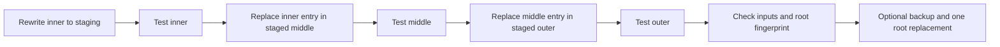

# Archive operations and data integrity

The core service owns archive mutations so every UI entry point follows the same
validation and commit rules. The main implementation is
[ArchiveService.swift](../macOS/Sources/VibeZipCore/ArchiveService.swift), with
streams in [Native.cpp](../macOS/Sources/CVibeZip/Native.cpp) and filesystem staging
in [FileOperations.swift](../macOS/Sources/VibeZipCore/FileOperations.swift).

## Opening nested archives

Opening an entry first requests `IInArchiveGetStream` from its parent handler.
If the resulting stream supports seeking through `IInStream`, the child opens
directly on that stream. Otherwise the bridge extracts that entry to a private
temporary file and opens the child there. Both routes retain the parent session.
The stream route avoids a full temporary copy when the format permits it; it
does not imply every compressed or solid archive can provide random access.

The root session has depth zero; the current guard permits child depths through
64. A nested entry must be a regular, safely named file. Each archive level keeps
its own password; errors distinguish a password needed by a containing archive
from one needed by the child.

The extraction limit defaults to 100 GiB and is configurable in Settings.
Declared sizes and actual output writes are checked for extraction and nested
spooling. A direct nested stream does not create that spool, so its input size
is not capped by the spool limit. Archive Test operations do not emit files and
do not use this output quota.

## Extraction

1. Resolve selection by native indexes or paths, including selected folders.
2. Validate names, duplicate paths, file/folder conflicts and conservative
   case/Unicode collisions. Reject symbolic links and hard links.
3. Extract into a private scratch directory with an output byte limit. Native
   data errors or cancellation at this stage leave the destination untouched.
4. Recheck the source fingerprint and merge validated output into the selected
   destination using full paths, a selected relative root or a flat layout.
5. Apply the selected conflict policy: auto-rename, skip or replace regular files.

Individual file copies stage into a sibling temporary file before committing.
The final merge is not an all-or-nothing directory transaction: cancellation or a
later copy error can leave earlier completed copies in place. A move keeps a
source tree when conflicts caused any items to be skipped.

## Updating an archive

Add, delete, rename and file replacement use one mutation path. An archive can
be changed only when its handler and every containing archive are writable.
Multivolume archives, including children inside them, are read only.

For an edit to `outer.7z → middle.zip → inner.7z`, the commit sequence is:

The transaction directory is beside the outer archive, allowing a final
same-filesystem `rename` to replace it atomically. The original stays in place
while each staged level is rewritten and tested. Encryption settings are
preserved through the chain, and required passwords are obtained before writes.
Input fingerprints and the original root fingerprint are checked before commit.
Backups are enabled by default and remain beside the archive until removed.

After the root replacement, the service invalidates and reopens affected
sessions from outermost to innermost. A refresh failure is reported separately:
it cannot undo an already committed edit. Cancellation before the replacement
keeps the original; cancellation after commit is not an undo operation.

Creating an archive also uses sibling staging, refuses an existing destination
and verifies output by default. Split outputs are committed as individual files;
an ordinary commit error attempts to remove the volumes already moved. This is
not a single atomic replacement of an entire volume set.

## Limits and open work

- Archive extraction and archive creation accept regular files and directories,
  not archive links or special files. Filesystem copy has a separate link policy.
- Path collision checks are conservative even on case-sensitive volumes.
  Duplicate entries can be browsed and selected by index, but ambiguous edits
  are rejected.
- Fingerprints detect common external changes but cannot exclude every race
  with a simultaneous writer. There is no transaction journal or crash recovery
  protocol, and atomic replacement is not a general power-loss durability claim.
- Codec work, a single `FileManager` copy and some system reads may take time to
  observe cancellation. Staging and verification require additional disk space;
  the output limit is not a complete CPU, memory or free-space budget.

[EngineIntegrationTests.swift](../macOS/Tests/VibeZipCoreTests/EngineIntegrationTests.swift)
covers nested writeback with different passwords, cancellation, external changes,
corrupt data, split archives, duplicate identities, runtime output limits and
seekable large nested inputs.
